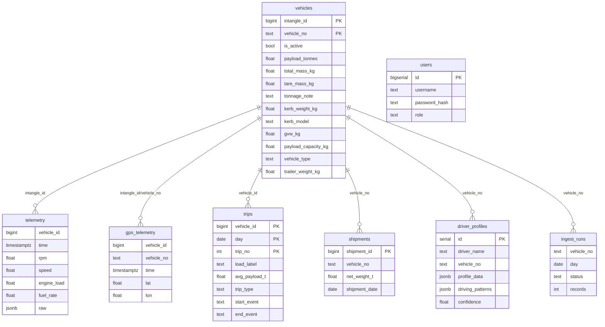
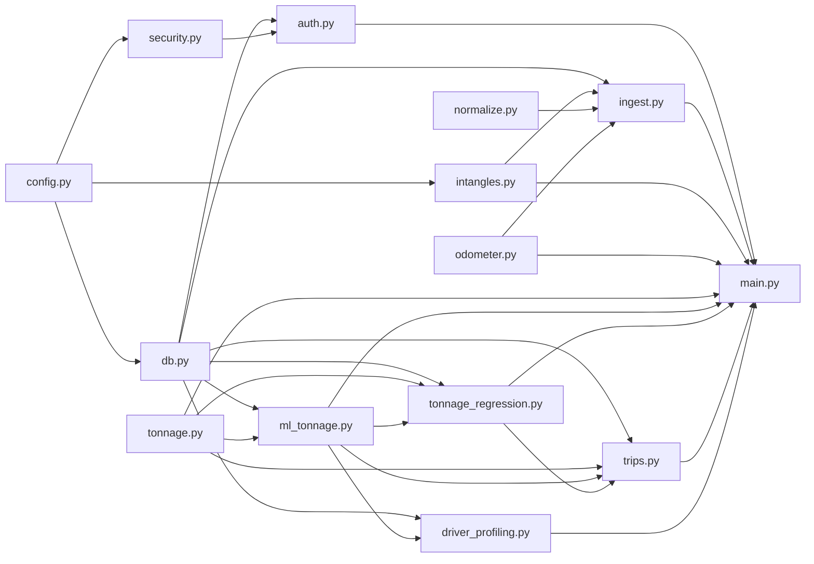

# Balaji Fleet Intangles — Complete Project Analysis

> **Date:** 2026-10-27 | **Codebase size:** ~320 KB source across 40+ files  
> **Stack:** Python 3.14 (FastAPI) + TimescaleDB/PostgreSQL + React 19 (Vite 8)

---

## 1. Architecture Overview

```mermaid
graph TB
    subgraph External
        INT["Intangles OBD/GPS API<br/>(only external dependency)"]
    end

    subgraph "Backend (Python / FastAPI)"
        API["FastAPI<br/>app/main.py (899 lines)"]
        ING["Data Ingestion<br/>app/ingest.py"]
        NRM["Normalizer<br/>app/normalize.py"]
        ICLI["Intangles Client<br/>app/intangles.py"]
        TON["Physics Tonnage Solver<br/>app/tonnage.py (635 lines)"]
        MLT["ML Tonnage (LightGBM)<br/>app/ml_tonnage.py (573 lines)"]
        REG["Payload Regressor<br/>app/tonnage_regression.py (416 lines)"]
        TRP["Trip Segmentation<br/>app/trips.py (647 lines)"]
        DRV["Driver Profiling<br/>app/driver_profiling.py (375 lines)"]
        AUTH["Auth (JWT + bcrypt)<br/>app/auth.py + security.py"]
        ODO["Odometer Resolution<br/>app/odometer.py"]
    end

    subgraph "Background Workers"
        LIVE["Live Poller<br/>scripts/live.py (60s)"]
        BF["Backfill<br/>scripts/backfill.py (45d history)"]
        TL["Train Loop<br/>scripts/train_loop.py (6h cycle)"]
        TRL["Trips Loop<br/>scripts/trips_loop.py (15min)"]
    end

    subgraph Database["TimescaleDB (PostgreSQL)"]
        VEH["vehicles"]
        TEL["telemetry (hypertable)"]
        GPS["gps_telemetry (hypertable)"]
        TRIPS["trips"]
        SHIP["shipments"]
        PROF["driver_profiles"]
        USR["users"]
        RUNS["ingest_runs"]
    end

    subgraph "Frontend (React 19 / Vite 8)"
        DASH["Dashboard"]
        VEH_PG["Vehicles Page"]
        VD["Vehicle Detail"]
        TT["Timetable (24h grid)"]
        OBS["Observation (Driver Profiles)"]
        MAP["Maps (Leaflet)"]
    end

    subgraph "ML Models (local, git-tracked)"
        CLS["loaded_empty_lgbm.txt<br/>(1 MB, LightGBM)"]
        REGM["payload_regressor.txt<br/>(1 MB, LightGBM)"]
        CAL["calibration.json"]
        ACC["accuracy_history.json"]
    end

    INT --> ICLI
    ICLI --> ING
    ING --> NRM
    NRM --> TEL & GPS
    LIVE --> ING
    BF --> ING
    TL --> MLT & REG & DRV
    TRL --> TRP

    API --> TEL & GPS & VEH & TRIPS & SHIP & PROF & USR
    API --> TON & MLT & REG & TRP & DRV

    DASH & VEH_PG & VD & TT & OBS & MAP --> API

    MLT --> CLS & CAL
    REG --> REGM
    TL --> ACC
```

---

## 2. Module-by-Module Breakdown

### 2.1 Backend (`app/`)

| File | Lines | Purpose | Complexity |
|---|---|---|---|
| [`main.py`](file:///c:/Balaji%20Fleet/app/main.py) | 899 | FastAPI app — 25+ endpoints, startup init, CORS, middleware | **High** — monolithic |
| [`tonnage.py`](file:///c:/Balaji%20Fleet/app/tonnage.py) | 635 | Physics-based virtual weighbridge (energy balance + accel + cruise estimators) | **Very High** — core IP |
| [`ml_tonnage.py`](file:///c:/Balaji%20Fleet/app/ml_tonnage.py) | 573 | LightGBM loaded/empty classifier, per-family calibration factors, window features | **High** |
| [`trips.py`](file:///c:/Balaji%20Fleet/app/trips.py) | 647 | Trip segmentation (>10min gaps), loaded/empty labelling, dwell windows, trip comparison | **High** |
| [`tonnage_regression.py`](file:///c:/Balaji%20Fleet/app/tonnage_regression.py) | 416 | Supervised payload regressor (shipment ground-truth labels), load/unload event detection | **High** |
| [`driver_profiling.py`](file:///c:/Balaji%20Fleet/app/driver_profiling.py) | 375 | DBSCAN clustering + IsolationForest anomaly detection, fleet percentile benchmarks | **Medium-High** |
| [`ingest.py`](file:///c:/Balaji%20Fleet/app/ingest.py) | 369 | Data pipeline: sync vehicles, ingest OBD + GPS, idempotent upserts, batch polling | **Medium** |
| [`normalize.py`](file:///c:/Balaji%20Fleet/app/normalize.py) | 141 | PID → named column mapping, J1939 SPN fallback chains, GPS normalization | **Low** |
| [`intangles.py`](file:///c:/Balaji%20Fleet/app/intangles.py) | 92 | HTTP client: JWT auth with auto-refresh, 401 retry, 5xx/transport retry (3×) | **Low** |
| [`odometer.py`](file:///c:/Balaji%20Fleet/app/odometer.py) | ~160 | Multi-source odometer resolution (245/EMS_245/mhn_blazo_245) | **Low** |
| [`auth.py`](file:///c:/Balaji%20Fleet/app/auth.py) | 70 | Register (first user → admin), login, JWT bearer auth | **Low** |
| [`security.py`](file:///c:/Balaji%20Fleet/app/security.py) | 35 | bcrypt + PyJWT helpers | **Low** |
| [`config.py`](file:///c:/Balaji%20Fleet/app/config.py) | 27 | pydantic-settings, `.env` config | **Low** |
| [`db.py`](file:///c:/Balaji%20Fleet/app/db.py) | 34 | psycopg3 connection factory, schema init | **Low** |

### 2.2 Scripts (`scripts/`)

| File | Purpose |
|---|---|
| [`init_db.sql`](file:///c:/Balaji%20Fleet/scripts/init_db.sql) | Full DDL: 8 tables, 2 hypertables, indexes (161 lines) |
| [`live.py`](file:///c:/Balaji%20Fleet/scripts/live.py) | Live poller daemon (60s interval, 900s lookback) |
| [`backfill.py`](file:///c:/Balaji%20Fleet/scripts/backfill.py) | Historical data backfill (configurable days) |
| [`train_loop.py`](file:///c:/Balaji%20Fleet/scripts/train_loop.py) | Self-training: retrain classifier/regressor/calibration + driver profiles every 6h |
| [`train_tonnage.py`](file:///c:/Balaji%20Fleet/scripts/train_tonnage.py) | One-shot classifier training |
| [`train_tonnage_regression.py`](file:///c:/Balaji%20Fleet/scripts/train_tonnage_regression.py) | One-shot regressor training |
| [`trips_loop.py`](file:///c:/Balaji%20Fleet/scripts/trips_loop.py) | Recompute last 3 days' trips every 15 min |
| [`tonnage.py`](file:///c:/Balaji%20Fleet/scripts/tonnage.py) | Batch tonnage estimation for fleet |
| [`ingest_weighbridge.py`](file:///c:/Balaji%20Fleet/scripts/ingest_weighbridge.py) | Ingest 1-year weighbridge ground-truth (training only, never shown) |
| [`ingest_specs.py`](file:///c:/Balaji%20Fleet/scripts/ingest_specs.py) | Ingest client spec sheets (GVW, payload capacity) |
| [`set_kerb.py`](file:///c:/Balaji%20Fleet/scripts/set_kerb.py) | Set per-vehicle kerb weight overrides |

### 2.3 Frontend (`web/src/`)

| File | Lines | Purpose |
|---|---|---|
| [`App.jsx`](file:///c:/Balaji%20Fleet/web/src/App.jsx) | 52 | React Router layout, protected routes, theme/auth context |
| [`Dashboard.jsx`](file:///c:/Balaji%20Fleet/web/src/pages/Dashboard.jsx) | 120 | Fleet overview: KPIs, load condition bar chart, fleet activity chart (Recharts) |
| [`VehicleDetail.jsx`](file:///c:/Balaji%20Fleet/web/src/pages/VehicleDetail.jsx) | 726 | Deep vehicle view: telemetry charts, tonnage bar, dwell windows, trip comparison, driver profile |
| [`Timetable.jsx`](file:///c:/Balaji%20Fleet/web/src/pages/Timetable.jsx) | 363 | 24h load schedule grid with trip badges, dwell bands, idle gradients |
| [`Vehicles.jsx`](file:///c:/Balaji%20Fleet/web/src/pages/Vehicles.jsx) | ~220 | Vehicle card grid with search/filter |
| [`Observation.jsx`](file:///c:/Balaji%20Fleet/web/src/pages/Observation.jsx) | 204 | Driver profiling: create/train profiles, anomaly list, fleet percentiles |
| [`Maps.jsx`](file:///c:/Balaji%20Fleet/web/src/pages/Maps.jsx) | 108 | Fleet map: Leaflet + OpenStreetMap, live/stopped markers |
| [`Topbar.jsx`](file:///c:/Balaji%20Fleet/web/src/components/Topbar.jsx) | ~130 | Navigation, dark/light theme toggle, logout |
| [`App.css`](file:///c:/Balaji%20Fleet/web/src/App.css) | ~1100 | Full design system: dark/light themes, KPI grids, panels, charts, timetable, maps |
| [`api.js`](file:///c:/Balaji%20Fleet/web/src/api.js) | 49 | Fetch wrapper, auth header injection, 401 auto-redirect |

---

## 3. ML Pipeline Analysis

### 3.1 Models (all local, no cloud AI)

| Model | Algorithm | Training Data | Metrics | Artifact |
|---|---|---|---|---|
| **Loaded/Empty Classifier** | LightGBM | 30,324 windows / 130 vehicles, labelled by `vehicle_load_cond` flag | Accuracy 0.894, AUC 0.958 | `models/loaded_empty_lgbm.txt` (1 MB) |
| **Payload Regressor** | LightGBM | 14,999 windows / 265 vehicles, labelled by shipment ground-truth | 5-fold CV MAE 5.24t, R² 0.886 | `models/payload_regressor.txt` (1 MB) |
| **Calibration Factors** | Statistical (median) | 8 vehicles with kerb weights + empty-flagged windows | Truck: 2.118×, Global: 2.192× | `models/calibration.json` |
| **Driver Profiling** | DBSCAN + IsolationForest | Per-vehicle sliding windows | Data-driven confidence score | Stored in `driver_profiles` table |

### 3.2 Feature Engineering (35 features)

The feature vector for each driving window includes:
- Speed statistics (mean, median, std, p90, max, CV, cruise fraction)
- RPM statistics (mean, median, std, p90)
- Engine load statistics (mean, median, std, p90)
- Fuel statistics (mean, median, std, sum, fuel per km)
- Acceleration statistics (pedal, deceleration, braking)
- Gear statistics (mean, median, change rate)
- Derived features: load/rpm ratio, fuel/speed ratio, power mean, **physics_mass_t** (calibrated energy-balance mass)

### 3.3 Training Loop

The self-training loop (`scripts/train_loop.py`) runs every 6 hours and:
1. Retrains the loaded/empty classifier from fresh data
2. Recalibrates per-family correction factors
3. Retrains the payload regressor against shipment ground truth
4. Recomputes driver profiles for all vehicles
5. Hot-reloads models via `POST /ingest/reload-models`

### 3.4 Accuracy Status

| Metric | Current | Target |
|---|---|---|
| **CV MAE** | 5.04t | — |
| **Manifest MAE** (live API vs weighbridge) | 7.49t | ±0.1t (NOT met) |
| **Classifier Accuracy** | 89.4% | — |
| **Classifier AUC** | 0.958 | — |

> [!WARNING]
> The ±100 kg (0.1t) absolute accuracy target is **NOT met**. The best deployment-style MAE is 6.34t. The primary bottleneck is: (1) no GPS elevation data for road grade correction, (2) OBD fuel rate under-reports actual consumption, (3) limited overlapping telemetry+shipment data.

---

## 4. Database Schema

**Key design decisions:**
- `telemetry` and `gps_telemetry` are **TimescaleDB hypertables** (time-partitioned for high-throughput ingest and efficient time-range queries)
- Idempotent upserts via `ON CONFLICT DO NOTHING`
- `ingest_runs` tracks every (vehicle, day) to prevent redundant API calls
- `vehicles` has composite PK `(intangle_id, vehicle_no)` to handle alias mapping

---

## 5. API Endpoints Summary (25+ routes)

| Method | Path | Purpose | Auth |
|---|---|---|---|
| `GET` | `/health` | DB status + row counts | None |
| `GET` | `/vehicles` | Fleet list with tonnage cache | User |
| `GET` | `/vehicles/{no}/profile` | Driver behaviour profile | User |
| `GET` | `/vehicles/{no}/load-events` | Payload timeline + load/unload events | User |
| `GET` | `/vehicles/{no}/dwell-events` | Loading/unloading/stop windows | User |
| `GET` | `/vehicles/{no}/trips` | Per-day trip segments | User |
| `GET` | `/vehicles/{no}/trip-comparison` | Empty vs loaded leg comparison | User |
| `GET` | `/telemetry` | Raw telemetry by vehicle + time range | User |
| `GET` | `/telemetry/fleet-activity` | Hourly moving/idling fleet counts | User |
| `GET` | `/telemetry/day-summary` | Per-hour vehicle stats | User |
| `GET` | `/live` | Real-time fleet readings (paginated) | User |
| `GET` | `/live/day` | Historical day snapshot | User |
| `GET` | `/timetable` | 24h load schedule with trips + dwells | User |
| `GET` | `/tonnage` | Physics-based tonnage estimate | User |
| `GET/POST/PUT/DELETE` | `/driver-profiles` | CRUD + train | Admin |
| `POST` | `/ingest/poll` | Trigger manual data poll | Admin |
| `POST` | `/ingest/backfill` | Trigger historical backfill | Admin |
| `POST` | `/ingest/sync-vehicles` | Sync vehicle list from Intangles | Admin |
| `POST` | `/ingest/reload-models` | Hot-reload ML models | Admin |
| `POST` | `/ingest/compute-trips` | Recompute trips | Admin |
| `POST/DELETE` | `/vehicles/kerb` | Set/clear kerb weight override | Admin |
| `POST` | `/auth/register` | Register (first user → admin) | None |
| `POST` | `/auth/login` | Login → JWT | None |
| `GET` | `/auth/me` | Current user info | User |

---

## 6. Strengths

### ✅ Fully In-House / Offline
- Zero cloud AI dependencies. All ML is LightGBM trained and inferred locally
- Models ship as git-tracked text dumps (~1 MB each)
- Self-training loop continuously improves without human intervention

### ✅ Deep Domain Engineering
- **Physics-based tonnage solver** using real longitudinal vehicle dynamics (F = ma + rolling + aero + grade)
- **Behavioural load estimator** that detects loaded vs empty from driving patterns alone
- **Triple-layer tonnage**: physics → ML classifier → supervised regressor
- **Dwell window detection**: real loading/unloading timing from dead-band gaps between trips

### ✅ Robust Data Pipeline
- Idempotent ingestion with `ON CONFLICT DO NOTHING`
- Advisory locks prevent race conditions during sync
- `ingest_runs` tracking avoids redundant API calls
- Automatic retry on 5xx/transport errors (3× with exponential backoff)
- Live poller + backfill + trip loop all run as supervised background workers

### ✅ Good Separation of Concerns
- Clean module boundaries: `intangles.py` (API client) → `normalize.py` (PID mapping) → `ingest.py` (pipeline) → `tonnage.py` (physics) → `ml_tonnage.py` (ML)
- Each ML component is independent and can be retrained in isolation

### ✅ Comprehensive Documentation
- The [AGENTS.md](file:///c:/Balaji%20Fleet/AGENTS.md) is exceptionally detailed (~52 KB) covering every PID, API quirk, data quality issue, and design decision
- Full Linux [deployment guide](file:///c:/Balaji%20Fleet/deployment%20guide.txt) with systemd/supervisord configs

---

## 7. Issues & Risks

### 🔴 Critical

| # | Issue | Location | Impact |
|---|---|---|---|
| 1 | **`main.py` is a 899-line monolith** — all 25+ endpoints in one file | [`main.py`](file:///c:/Balaji%20Fleet/app/main.py) | Maintenance nightmare, merge conflicts, hard to test |
| 2 | **Raw SQL everywhere with string formatting** — `f"SELECT ... WHERE {where}"` | [`main.py`](file:///c:/Balaji%20Fleet/app/main.py#L461) | SQL injection risk (params are used, but the pattern is fragile) |
| 3 | **No connection pooling** — `psycopg.connect()` per request | [`db.py`](file:///c:/Balaji%20Fleet/app/db.py#L7-L8) | Under load, will exhaust DB connections |
| 4 | **JWT secret is hardcoded default** — `"dev-secret-change-me"` | [`config.py`](file:///c:/Balaji%20Fleet/app/config.py#L22) | Anyone can forge admin tokens in production |
| 5 | **CORS allows all origins** — `allow_origins=["*"]` | [`main.py`](file:///c:/Balaji%20Fleet/app/main.py#L31) | No protection against cross-origin attacks |
| 6 | **`supervisord.conf` has hardcoded macOS paths** | [`supervisord.conf`](file:///c:/Balaji%20Fleet/supervisord.conf) | Won't work on Windows or Linux deployment |
| 7 | **`requirements.txt` is incomplete** — missing `lightgbm`, `numpy`, `scikit-learn`, `bcrypt`, `pyjwt`, `pandas` | [`requirements.txt`](file:///c:/Balaji%20Fleet/requirements.txt) | Fresh `pip install -r requirements.txt` will fail |

### 🟡 Moderate

| # | Issue | Location | Impact |
|---|---|---|---|
| 8 | **No test suite whatsoever** — zero unit/integration/e2e tests | Entire project | Regressions go undetected |
| 9 | **Deprecated `@app.on_event("startup")`** — replaced by lifespan in modern FastAPI | [`main.py`](file:///c:/Balaji%20Fleet/app/main.py#L37) | Future compatibility |
| 10 | **Row-by-row INSERT** in `_insert_telemetry` | [`ingest.py`](file:///c:/Balaji%20Fleet/app/ingest.py#L50-L73) | 10-100× slower than `COPY` or `executemany` for bulk ingest |
| 11 | **`dangerouslySetInnerHTML`** in Maps popup | [`Maps.jsx`](file:///c:/Balaji%20Fleet/web/src/pages/Maps.jsx#L89-L91) | XSS if vehicle_type contains user-controlled HTML |
| 12 | **VehicleDetail.jsx is 726 lines** — one massive component | [`VehicleDetail.jsx`](file:///c:/Balaji%20Fleet/web/src/pages/VehicleDetail.jsx) | Hard to maintain, slow to render |
| 13 | **No TypeScript** — all `.jsx` with no type checking | `web/src/` | Runtime type errors in production |
| 14 | **No API versioning** — all endpoints at root | `app/main.py` | Breaking changes affect all clients |
| 15 | **Model hot-reload is manual** — requires admin `POST /ingest/reload-models` | [`main.py`](file:///c:/Balaji%20Fleet/app/main.py#L717-L732) | Stale models served if admin forgets to reload |

### 🟢 Minor / Nice-to-Have

| # | Issue | Impact |
|---|---|---|
| 16 | No rate limiting on auth endpoints | Brute-force login attacks possible |
| 17 | No structured logging (just `print()`) | Hard to debug in production |
| 18 | No health check for background workers | Workers can fail silently |
| 19 | No data retention policy | Telemetry will grow unbounded |
| 20 | `Cache-Control: no-store` on all responses | No client-side caching even for static data |

---

## 8. Code Quality Metrics

| Metric | Score | Notes |
|---|---|---|
| **Modularity** | 6/10 | Good module boundaries, but `main.py` and `VehicleDetail.jsx` are monolithic |
| **Documentation** | 9/10 | Exceptional AGENTS.md + inline docstrings + deployment guide |
| **Error Handling** | 7/10 | Good retry logic in API client, but inconsistent in endpoints (some return tuples instead of `HTTPException`) |
| **Security** | 4/10 | JWT auth exists but default secret, no CORS, XSS in Maps |
| **Testability** | 2/10 | No tests, tight coupling to DB |
| **Performance** | 5/10 | No connection pooling, row-by-row inserts, heavy LATERAL JOINs |
| **Maintainability** | 6/10 | Well-organized but large files need splitting |
| **Scalability** | 5/10 | TimescaleDB is good, but single-process API + no caching |

---

## 9. Technology Stack Summary

### Backend
| Component | Technology | Version |
|---|---|---|
| Web Framework | FastAPI | Latest |
| Database | PostgreSQL + TimescaleDB | 18 + 2.29 |
| DB Driver | psycopg (v3) | Latest |
| HTTP Client | httpx | Latest |
| ML Framework | LightGBM | Latest |
| Clustering | scikit-learn (DBSCAN, IsolationForest) | Latest |
| Auth | bcrypt + PyJWT | Latest |
| Process Manager | supervisord | Latest |

### Frontend
| Component | Technology | Version |
|---|---|---|
| UI Framework | React | 19.2 |
| Build Tool | Vite | 8.2 |
| Routing | react-router-dom | 7.18 |
| Charts | Recharts | 3.10 |
| Maps | Leaflet + react-leaflet | 1.9 + 5.0 |
| Linting | oxlint | 1.75 |

---

## 10. Recommended Improvements (Priority Order)

### P0 — Security & Production Readiness
1. **Fix JWT secret** — require `JWT_SECRET` from environment, fail startup if default
2. **Lock CORS origins** — whitelist specific domains
3. **Add connection pooling** — use `psycopg_pool.ConnectionPool` or `psycopg_pool.AsyncConnectionPool`
4. **Complete `requirements.txt`** — add all actual dependencies with pinned versions
5. **Fix `supervisord.conf`** paths to be environment-relative

### P1 — Code Quality
6. **Split `main.py`** into route modules (`routers/vehicles.py`, `routers/telemetry.py`, `routers/ingest.py`, etc.)
7. **Split `VehicleDetail.jsx`** into sub-components
8. **Add a test suite** — at minimum, API route tests with a test DB
9. **Use `executemany` or `COPY`** for bulk telemetry inserts
10. **Remove `dangerouslySetInnerHTML`** from Maps

### P2 — Feature Completeness
11. **Tonnage physics+ML blend** — weighted combination of physics solver and regressor (not yet built per AGENTS.md)
12. **Fuel-burn forecasting** — time-series prediction (not yet built)
13. **GPS elevation integration** — road grade correction for tonnage solver
14. **Auth hardening** — role management UI, password reset, session management

### P3 — Operational Excellence
15. **Structured logging** — use Python's `logging` module with JSON output
16. **API versioning** — prefix all routes with `/api/v1/`
17. **Data retention** — configure TimescaleDB compression + retention policies
18. **Monitoring** — add Prometheus metrics endpoint
19. **CI/CD pipeline** — automated testing + deployment

---

## 11. File Dependency Graph

---

## 12. Summary

**Balaji Fleet Intangles** is a sophisticated fleet telemetry platform that ingests real-time OBD + GPS data from 614 vehicles and provides:

- **Virtual weighbridge** — physics + ML payload estimation without physical scales
- **Trip intelligence** — automatic segmentation with loaded/empty classification
- **Dwell detection** — real loading/unloading timing from telemetry gaps
- **Driver profiling** — behaviour clustering and anomaly detection
- **Live fleet dashboard** — 24h timetable, maps, vehicle detail with charts

The core **domain engineering** (tonnage physics solver, behavioural load estimator, trip segmentation) is impressive and well-documented. The **self-training pipeline** that continuously improves models without human intervention is a strong architectural choice.

The main areas needing attention are **security hardening** (JWT, CORS), **code organization** (splitting monolithic files), **testing** (zero tests currently), and **performance** (connection pooling, bulk inserts). The tonnage accuracy gap (MAE 7.5t vs target 0.1t) is primarily a data/sensor limitation rather than a code issue.
